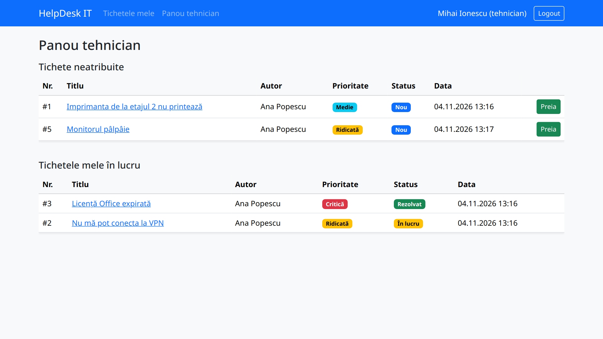
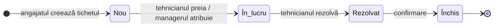
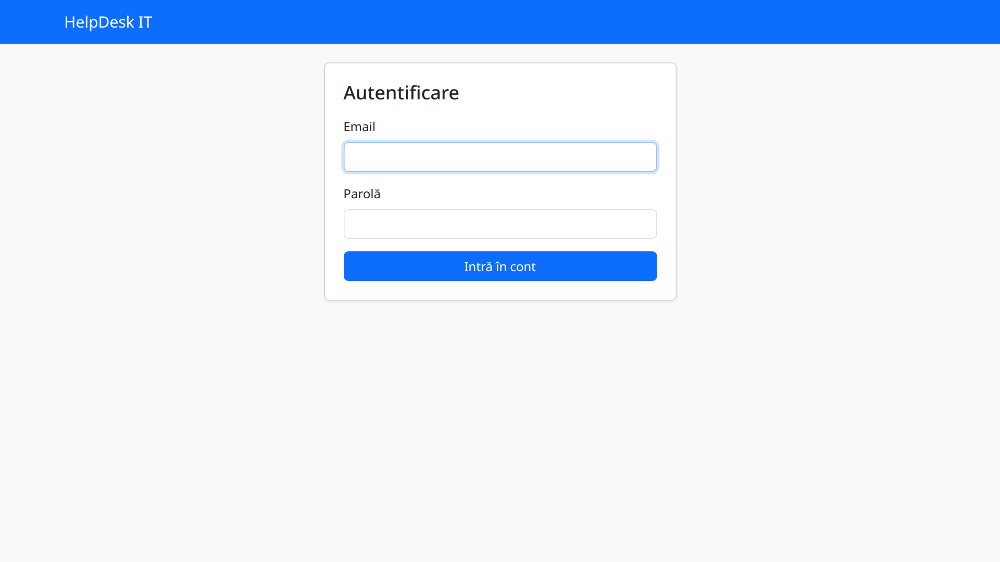
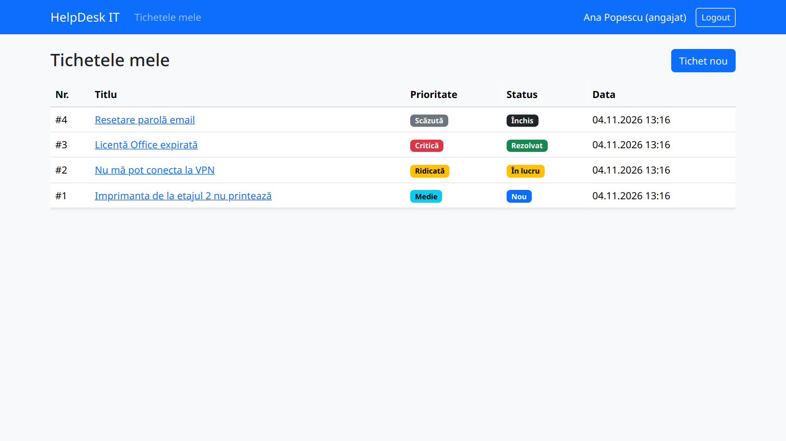
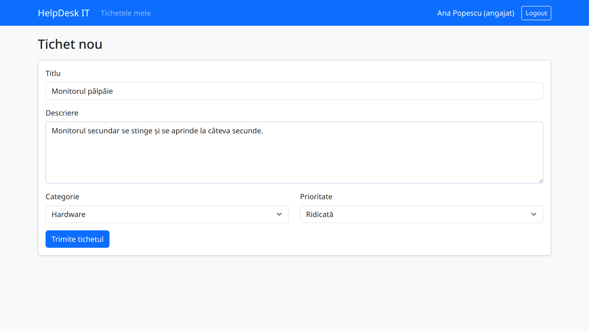
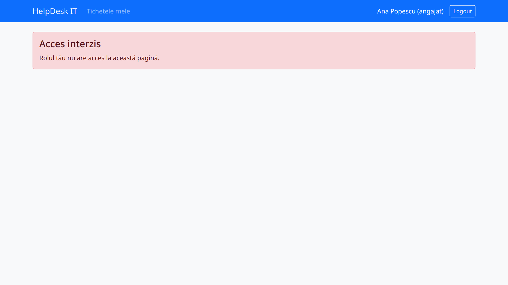
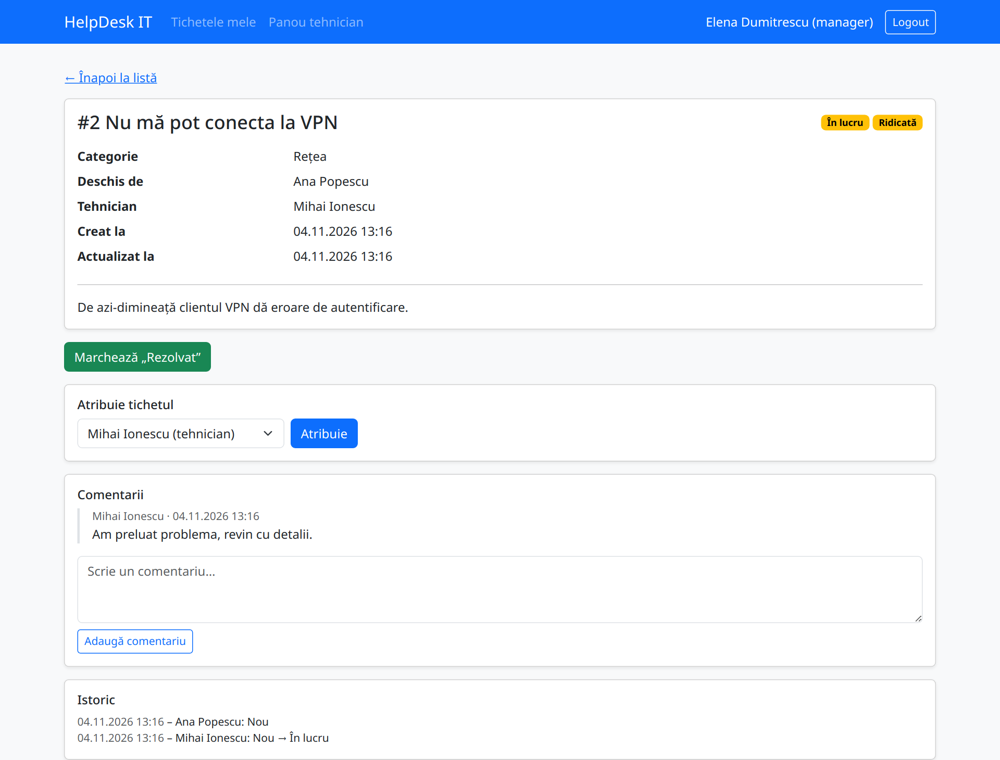
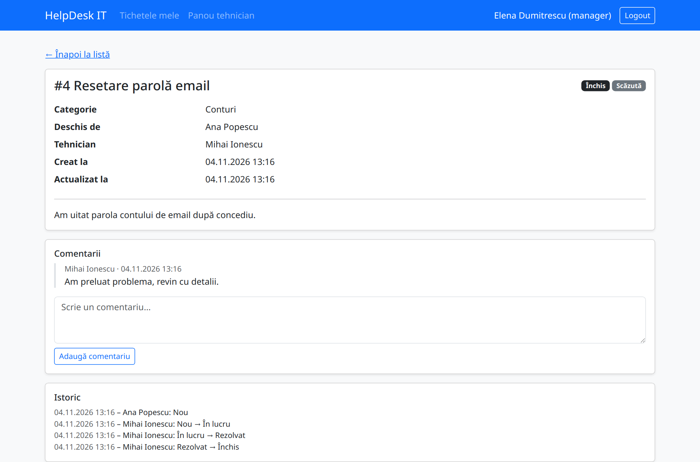
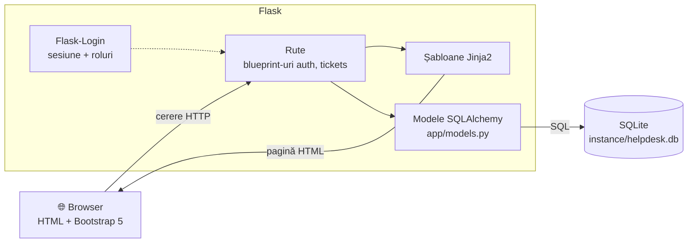

<div align="center">

# 🛠️ HelpDesk IT

**Sistem web de gestionare a tichetelor de suport tehnic**

Angajații raportează problemele tehnice sub formă de tichete, iar echipa IT le preia,
le rezolvă și le urmărește până la închidere – totul într-un singur loc, cu istoric complet.

[](https://github.com/vaduvalex17/HelpDesk-proiect/actions/workflows/ci.yml)




</div>

---

## Cuprins

- [Despre proiect](#despre-proiect)
- [Funcționalități](#funcționalități)
- [Pornire rapidă](#pornire-rapidă)
- [Instalare pas cu pas](#instalare-pas-cu-pas)
- [Conturi de test](#conturi-de-test)
- [Capturi de ecran](#capturi-de-ecran)
- [Arhitectură](#arhitectură)
- [Structura proiectului](#structura-proiectului)
- [Teste și calitatea codului](#teste-și-calitatea-codului)
- [Documentație](#documentație)
- [Probleme frecvente](#probleme-frecvente)

---

## Despre proiect

**HelpDesk IT** a fost realizat pentru clientul (fictiv) **TechNova Solutions SRL**, ale cărui cereri
de suport tehnic se pierdeau pe email și telefon. Aplicația înlocuiește acest flux cu tichete
care au **autor, prioritate, categorie, responsabil, status, comentarii și istoric**.

| Actor | Ce poate face |
|---|---|
| 👤 **Angajat** | Deschide tichete, își vede **doar** propriile tichete, comentează pe ele |
| 🔧 **Tehnician IT** | Vede tichetele neatribuite, le preia, avansează statusul, comentează |
| 📋 **Manager IT** | Tot ce poate tehnicianul + atribuie orice tichet oricărui tehnician |

Ciclul de viață al unui tichet:



Fiecare tranziție se salvează în **istoric** (cine, când, din ce status în ce status), iar etapele nu pot fi sărite.

---

## Funcționalități

| Cod | Funcționalitate | Stare |
|---|---|:---:|
| F1 | Autentificare cu email și parolă, deconectare | ✅ |
| F2 | Creare tichet (titlu, descriere, categorie, prioritate) cu validare pe server | ✅ |
| F3 | Lista „Tichetele mele” | ✅ |
| F4 | Pagina de detaliu a tichetului (un angajat nu vede tichetele altora) | ✅ |
| F5 | Roluri și permisiuni verificate pe server (pagină 403 în română) | ✅ |
| F6 | Panoul tehnicianului: preluarea tichetelor neatribuite | ✅ |
| F7 | Atribuirea tichetelor de către manager | ✅ |
| F8 | Fluxul de status Nou → În lucru → Rezolvat → Închis, cu istoric | ✅ |
| F9 | Comentarii pe tichet, cu autor și dată | ✅ |
| F10–F14 | Filtrare, dashboard, administrare, alertă SLA, notificări email | 🗓️ planificat |

Specificația completă: [`docs/specificatii.md`](docs/specificatii.md).

**Securitate:** parolele se salvează doar ca hash (Werkzeug), accesul se verifică pe server după rol,
logout-ul se face prin POST, iar redirecționarea după login acceptă doar adrese locale.

---

## Pornire rapidă

> Ai nevoie doar de **[Python 3.12+](https://www.python.org/downloads/)** și **[Git](https://git-scm.com/downloads)**.

```bash
git clone https://github.com/vaduvalex17/HelpDesk-proiect.git
cd HelpDesk-proiect
```

Apoi o singură comandă, care face tot (mediu virtual, dependențe, date demo, server, browser):

| Sistem | Comandă |
|---|---|
| 🪟 **Windows** | dublu-clic pe **`1. Porneste aplicatia.bat`** (dacă Python lipsește, îl instalează singur) |
| 🐧 **Linux** / 🍎 **macOS** | `bash scripts/prezentare.sh` |

Aplicația se deschide singură în browser la **http://127.0.0.1:5000** (sau la următorul port liber).
Oprire: închide fereastra (Windows) sau **Ctrl+C** în terminal.

Testele automate se rulează cu dublu-clic pe **`2. Ruleaza testele.bat`** (Windows).

> 💡 Datele demo se resetează la fiecare pornire. Ca să păstrezi tichetele create: `python scripts/prezentare.py --pastreaza`.

---

## Instalare pas cu pas

Dacă preferi să rulezi manual fiecare pas:

<details open>
<summary><b>🐧 Linux / 🍎 macOS</b></summary>

```bash
# 1. Mediul virtual (o cutie izolată pentru bibliotecile proiectului)
python3 -m venv .venv
source .venv/bin/activate

# 2. Dependențele
pip install -r requirements.txt

# 3. Baza de date cu date de test (--demo adaugă și câteva tichete)
python seed.py --demo

# 4. Serverul
flask --app app run --debug
```
</details>

<details>
<summary><b>🪟 Windows (PowerShell)</b></summary>

```powershell
# 1. Mediul virtual
py -m venv .venv
.venv\Scripts\Activate.ps1
# dacă PowerShell blochează scriptul: Set-ExecutionPolicy -Scope CurrentUser RemoteSigned

# 2. Dependențele
pip install -r requirements.txt

# 3. Baza de date cu date de test
python seed.py --demo

# 4. Serverul
flask --app app run --debug
```
</details>

Deschide **http://127.0.0.1:5000** în browser.

Pentru dezvoltare (Linux / macOS) există și `bash scripts/run.sh` (opțiuni: `--reset`, `--port 5001`),
care pornește serverul în modul debug, cu reîncărcare automată la modificarea codului.

### Configurare (opțional)

| Variabilă de mediu | Implicit | Rol |
|---|---|---|
| `SECRET_KEY` | `dev-doar-local` | Cheia de semnare a sesiunii – **schimb-o în producție** |
| `DATABASE_URL` | `sqlite:///instance/helpdesk.db` | Adresa bazei de date |

---

## Conturi de test

Toate datele sunt **fictive** (conform GDPR – cerința N3). Parola pentru toate conturile: **`parola123`**

| Rol | Nume | Email |
|---|---|---|
| Angajat | Ana Popescu | `angajat@technova.test` |
| Tehnician | Mihai Ionescu | `tehnician@technova.test` |
| Manager | Elena Dumitrescu | `manager@technova.test` |

---

## Capturi de ecran

<table>
  <tr>
    <td align="center"><br><sub><b>Autentificare</b></sub></td>
    <td align="center"><br><sub><b>Tichetele mele</b> (angajat)</sub></td>
  </tr>
  <tr>
    <td align="center"><br><sub><b>Creare tichet</b></sub></td>
    <td align="center"><br><sub><b>Acces interzis</b> – angajatul pe panoul tehnic</sub></td>
  </tr>
  <tr>
    <td align="center"><br><sub><b>Detaliu tichet</b> – vederea managerului</sub></td>
    <td align="center"><br><sub><b>Comentarii și istoric</b></sub></td>
  </tr>
</table>

---

## Arhitectură

Aplicație web clasică, generată pe server, cu trei straturi într-un singur proces Flask:



| Strat | Tehnologie |
|---|---|
| Limbaj | Python 3.12+ |
| Framework web | Flask 3.1 (application factory + blueprint-uri) |
| Acces la date | SQLAlchemy (ORM) prin Flask-SQLAlchemy |
| Bază de date | SQLite |
| Autentificare | Flask-Login + hash Werkzeug |
| Interfață | Jinja2 + Bootstrap 5.3 (responsive) |
| Calitate | pytest, Ruff, GitHub Actions |

Detalii: [`docs/arhitectura.md`](docs/arhitectura.md) · Model de date (ERD): [`docs/diagrame/erd.puml`](docs/diagrame/erd.puml)

---

## Structura proiectului

```
HelpDesk-proiect/
├── app/
│   ├── __init__.py          # create_app(): configurare, extensii, blueprint-uri
│   ├── extensions.py        # instanțele db (SQLAlchemy) și login_manager
│   ├── models.py            # User, Category, Ticket, TicketHistory, Comment
│   ├── auth/                # F1, F5 – login, logout, decoratorul role_required
│   ├── tickets/             # F2–F4, F6–F9 – rutele pentru tichete
│   └── templates/           # paginile HTML (Jinja2 + Bootstrap)
├── tests/                   # teste automate pytest
├── scripts/
│   ├── prezentare.py        # pornire „cu un clic” + deschidere browser + teste
│   ├── prezentare.sh        # lansator pentru Linux/macOS
│   ├── windows/             # găsirea / instalarea automată a lui Python pe Windows
│   └── run.sh               # pornire pentru dezvoltare (mod debug)
├── 1. Porneste aplicatia.bat  # Windows: dublu-clic pentru pornire
├── 2. Ruleaza testele.bat     # Windows: dublu-clic pentru teste
├── docs/                    # specificații, arhitectură, diagrame, capturi
├── seed.py                  # date fictive de test (--demo pentru tichete)
├── requirements.txt         # dependențele aplicației
└── requirements-dev.txt     # + pytest și Ruff
```

Codul este comentat în limba română: fiecare modul, clasă și funcție are un docstring care explică ce face.

---

## Teste și calitatea codului

```bash
pip install -r requirements-dev.txt
pytest -q          # rulează testele automate
ruff check .       # verifică stilul și erorile frecvente
```

Testele folosesc o bază de date SQLite **în memorie**, nouă pentru fiecare test, deci nu ating datele reale.
La fiecare `push` pe `main` și la fiecare pull request, **GitHub Actions** rulează automat Ruff și pytest
([`.github/workflows/ci.yml`](.github/workflows/ci.yml)).

---

## Documentație

| Document | Conținut |
|---|---|
| [`docs/specificatii.md`](docs/specificatii.md) | Actori, cerințe funcționale (F1–F14) și nefuncționale (N1–N7) |
| [`docs/tehnologii.md`](docs/tehnologii.md) | Tehnologiile alese și motivul alegerii |
| [`docs/arhitectura.md`](docs/arhitectura.md) | Straturile aplicației și fluxul unei cereri |
| [`docs/diagrame/`](docs/diagrame/) | Diagrame PlantUML: cazuri de utilizare, ERD |
| [`ROADMAP.md`](ROADMAP.md) | Planul proiectului, issue cu issue |

Fiecare cerință are un cod (ex. **F2**), un issue pe GitHub (**#17**), commit-uri `feat: … (#17)` și teste asociate – **trasabilitate** completă de la cerință la cod.

---

## Probleme frecvente

<details>
<summary><b>„python” / „py” nu este recunoscut</b></summary>

Python nu e instalat sau nu e în PATH. Reinstalează-l de pe [python.org](https://www.python.org/downloads/) și bifează **„Add Python to PATH”** la instalare (Windows).
</details>

<details>
<summary><b>Portul 5000 este ocupat</b></summary>

`scripts/prezentare.py` alege automat următorul port liber. Manual: `flask --app app run --port 5001`.
Pe macOS, portul 5000 este folosit uneori de AirPlay Receiver.
</details>

<details>
<summary><b>Vreau să încep cu date curate</b></summary>

`python seed.py --demo` (sau `python seed.py` fără tichete) recreează baza de date.
**Atenție:** se pierd toate datele existente.
</details>

<details>
<summary><b>Pagina apare fără stiluri</b></summary>

Bootstrap se încarcă de pe CDN, deci e nevoie de conexiune la internet.
</details>

---

<div align="center">
<sub>Proiect pentru disciplina <b>Managementul Proiectelor Software</b> · client fictiv TechNova Solutions SRL · 2026–2027</sub>
</div>
